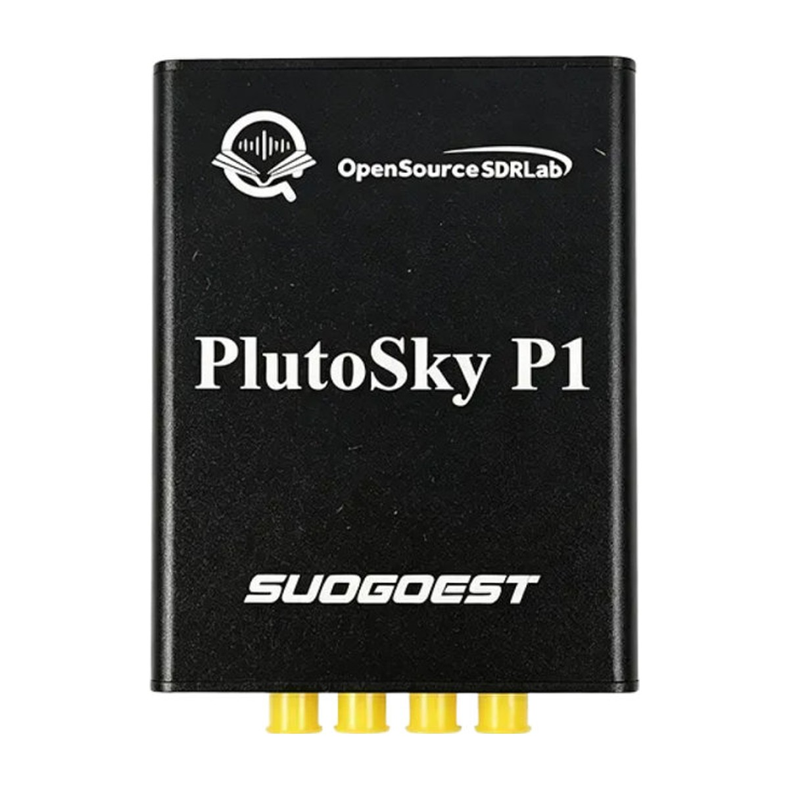
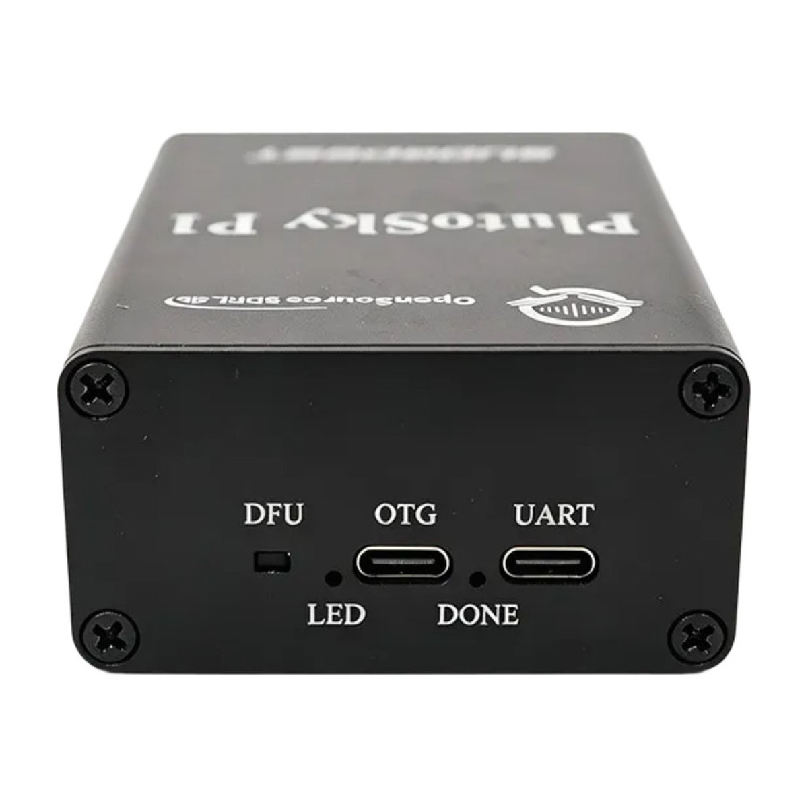

# PlutoSky-P1

Hardware files and documentation for the **OpenSourceSDRLab PlutoSky P1**, a pocket-size software-defined radio based on the Analog Devices ADALM-PLUTO design and fully compatible with its official firmware and software.

  
  

## Product link

<https://opensourcesdrlab.com/products/plutosky-p1>

## About the board

- RF transceiver: Analog Devices **AD9363**, 2 transmit and 2 receive channels (TX1/RX1/TX2/RX2 on SMA connectors), full duplex
- Tuning range 325–3800 MHz as shipped; 70–6000 MHz after switching the firmware to AD9364/AD9361 mode (see the Quick Start Guide)
- Up to 20 MHz instantaneous bandwidth, 61.44 MSPS, 12-bit ADC/DAC, 40 MHz reference clock
- SoC: Xilinx Zynq **XC7Z010-1CLG225**, DDR3L memory, QSPI flash
- Two USB-C ports: **OTG** (data and power, USB network and mass-storage interface) and **UART** (serial console via a CH340 bridge); DFU button, status LEDs
- Firmware: the official Analog Devices [plutosdr-fw](https://github.com/analogdevicesinc/plutosdr-fw) runs unchanged; works with libiio, IIO Oscilloscope, GNU Radio, MATLAB/Simulink and SDR applications that support the PlutoSDR

## Quick start

1. Install the PlutoSDR USB drivers from Analog Devices (Windows) and connect the **OTG** port to the PC.
2. The board appears as a USB network adapter and a USB drive; it answers at `192.168.2.1`.
3. Check the link with `iio_info -u ip:192.168.2.1`, then open your SDR software.

The full steps are in the **[Quick Start Guide](docs/Quick-Start-Guide.md)** ([PDF](docs/Quick-Start-Guide.pdf)).

## User manual

The detailed user manual and GNU Radio tutorials are on the OpenSourceSDRLab blog: <https://blog.opensourcesdrlab.com/archives/plutosky-p1-user-manual>

## Repository layout

| Path | Contents |
|---|---|
| `hardware/` | Board schematic (PDF) |
| `docs/` | Quick Start Guide (Markdown and PDF) |
| `images/` | Product photos |

## Firmware

The PlutoSky P1 uses the official Analog Devices PlutoSDR firmware. Download it from the [plutosdr-fw releases](https://github.com/analogdevicesinc/plutosdr-fw/releases); no board-specific firmware is needed.

## Licence

Files created by OpenSourceSDRLab are released under the [Apache License 2.0](LICENSE). See [NOTICE.md](NOTICE.md) for details and trademarks.

## Support

- Email: support@opensourcesdrlab.com
- Forum: <https://forum.opensourcesdrlab.com>
- Discord: <https://discord.gg/nnxY6DkmvT>
- Blog and user manuals: <https://blog.opensourcesdrlab.com>

---
© 2026 OpenSourceSDRLab. All rights reserved. · <a href="https://www.opensourcesdrlab.com">www.opensourcesdrlab.com</a>
